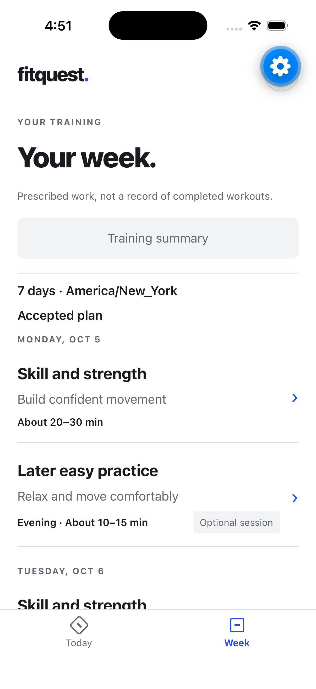
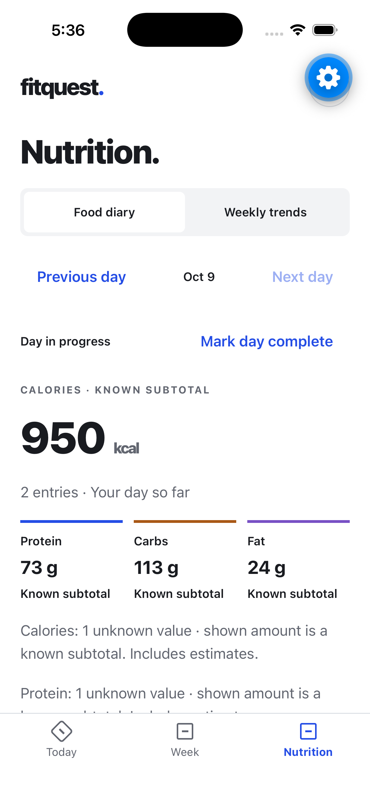

# FitQuest

FitQuest is an iOS-focused training and nutrition app for adults. It turns five written intake answers into a weekly plan, keeps prescribed work separate from actual workout results, and brings food, weight and training history together for the next week.

This repository contains the current application plus a **private, non-deploying cleanup branch**, `codex/publication-safety`. The deployed application was last verified at `2e779e5` on October 9, 2026; documentation and cleanup commits do not constitute a deployment or App Store release. Feature work is paused during repository preparation.

## What it does

- **Plan and review:** five progressive intake questions, a complete Monday–Sunday plan with multiple sessions, rest and optional work, explicit revisions, and an overview before acceptance. Accepting or reopening a saved plan makes no AI call.
- **Train and record:** Today and Week views, readable workout instructions, actual sets/reps/weight or completion, notes, corrections and workout history. Logging does not imply that every prescription was completed.
- **Track nutrition:** a food diary with manual entry or explicitly requested AI estimates, reviewed candidates, known/unknown nutrient values, daily completion and weekly trends. Saved meals and versioned recipes support fractional servings; later edits preserve earlier diary entries.
- **Continue across weeks:** dated weight history and progress-informed upcoming plans with separate permission to share workout/weight history and health notes with OpenAI. Optional Sunday 9 PM planning uses the enrolled timezone; generated drafts still require **Use this plan**. Accepted weeks and nutrition targets apply by date.

Logging, meal-library arithmetic and saved-plan acceptance are deterministic. Generation, explicit revisions and AI food interpretation use the same permanent spending ledger. A failed or uncertain paid request is not automatically retried.

## Screens

Historical native captures from October 9, 2026, using synthetic fixtures. They illustrate implemented flows, not real athlete data, a fresh phone test or today's exact navigation. Expo's blue gear is a development overlay.

| Saved week | Food diary |
| --- | --- |
|  |  |

[Screen provenance and limitations](docs/reference/screenshots.md).

## Architecture

| Layer | Responsibility |
| --- | --- |
| `mobile/` | React Native 0.86, React 19, Expo SDK 57 and TypeScript; account-scoped UI and recoverable SecureStore drafts. |
| `backend/` | Fastify 5 on Node 24; verified Supabase sessions, application authorization, validation, AI dispatch/accounting and the production scheduler. |
| Supabase | Email/password Auth and PostgreSQL. Private application tables are accessed through the API using the restricted database role and owner-scoped transactions. |
| `backend/src/shared/` | Eight platform-neutral contracts consumed by both API and mobile, kept inside the existing Docker build context. |
| `backend/setup/` | Checksum-verified, non-destructive fresh installation; historical reset migrations are not a setup recipe. |
| `.github/workflows/` | Formatting, lint, types, isolated PostgreSQL/mobile regressions, packaging, dependency triage and full-history secret scanning. |

A single model request saves a complete document plan; a small display contract keeps flexible exercise instructions without a mandatory catalog. The server withholds workout details until acceptance. Legacy saved formats remain readable. This avoids a second paid extraction step, while leaving coaching quality dependent on the model output.

Sunday scheduling runs inside the existing production API process rather than a separate job service. Durable attempts and date-aware recovery prevent duplicate requests, but service downtime can delay generation. See [architecture and operational limits](docs/reference/architecture.md).

## Develop and verify

Use Node **24.21.0** (`.nvmrc`), npm, and PostgreSQL server/client tools on macOS or Linux. From the repository root:

```sh
npm ci --ignore-scripts
npm ci --prefix backend --ignore-scripts
npm ci --prefix mobile --ignore-scripts
npm run check
npm run check:database
npm run check --prefix mobile
npm run audit:dependencies
```

These checks use mocks and a disposable local database, without production credentials or paid AI. `check:database` refuses an occupied test port and stops its own cluster. Without it, the ordinary test command skips database suites. See [development checks](docs/guides/development.md) for details.

To run the application, follow [API configuration and fresh setup](backend/README.md) and [mobile setup](mobile/README.md). Environment examples contain placeholders; no hosted access or AI allowance is provisioned automatically. Keep owner-managed servers separate from temporary tests.

## Status and limits

Batch 2 passed [GitHub Actions at `54e0b03`](https://github.com/nsoterop/FitQuest/actions/runs/38023698280), including isolated database checks. Its local record contains 301 backend, 5 installation, 128 mobile and 7 repository tests, plus an offline iOS export. These are dated results, not proof of physical-phone acceptance or coaching quality.

Two upstream mobile-tooling advisories remain: `braces` and `node-forge`, producing 16 propagated high audit findings at the cleanup checkpoint. They have explicit time-limited CI exceptions, not fixes. See [security guidance](SECURITY.md) and [dependency evidence](docs/archive/audits/publication-safety-2026-10-09.md#dependency-triage).

A real Sunday dispatch, full physical-phone acceptance and VoiceOver coverage remain unverified. The largest accessibility-only text size can overlap the shared header/navigation. Public email signup also requires an appropriate email-delivery configuration. See [known limitations](docs/reference/architecture.md#known-limitations).

[Documentation index](docs/README.md) · [Repository layout](docs/guides/repository-layout.md) · [Contributing](CONTRIBUTING.md) · [Current agent rules](AGENTS.md) · [Historical release evidence](docs/archive/README.md)

## License

FitQuest project code is available under the [MIT License](LICENSE), copyright 2026 nsoterop. Existing [Expo attribution](mobile/LICENSE) and other dependency notices retain their original terms; see [third-party notices](THIRD_PARTY_NOTICES.md).
