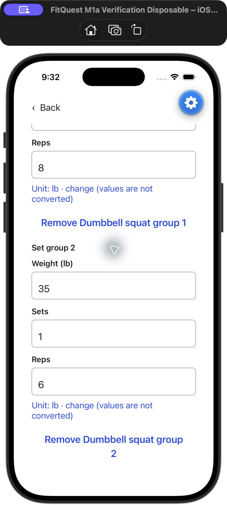
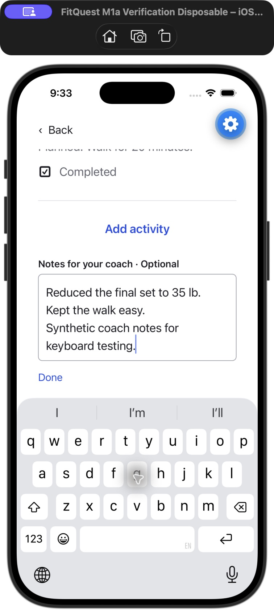
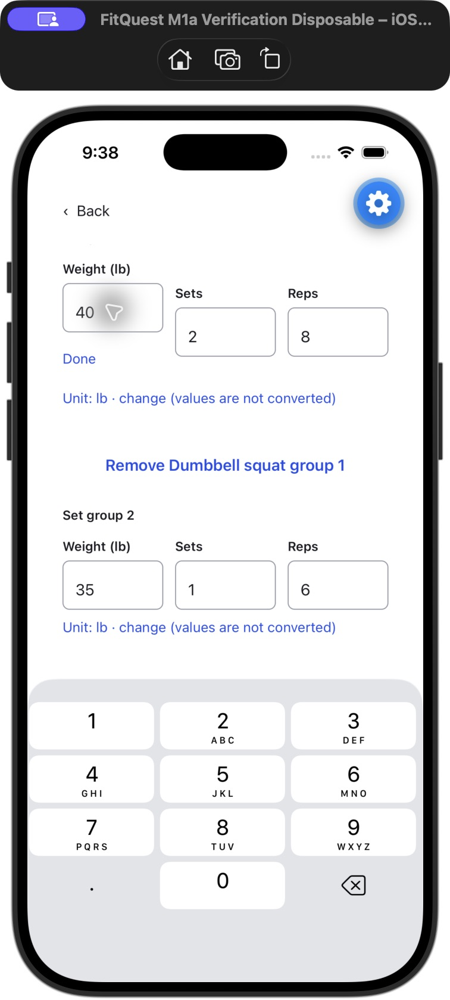

# Workout journal slice 1 — 2026-10-09

Weighted rows offer weight/sets/reps, unweighted rows sets/reps, and everything else a completion checkbox. Original prescriptions remain visible. Numeric actuals start blank, zero stays distinct, optional set groups retain different values, and removal/type changes preserve input. One optional bottom notes field stays private to the journal. Save is independent from explicit completed/partial/skipped outcomes; finishing never fills missing results. History is available from Account, including unplanned work and past plans. Separate occurrences require the explicit action.

## Verification

- 285 backend tests passed with isolated PostgreSQL and zero skips; 123 mobile tests and both TypeScript checks passed. Mock requests verify only the small v4 display hint/paragraph was added, free acceptance/reopen and legacy readers remain. No paid request was dispatched.
- Persistence checks cover exact accepted revision snapshots, multiple sessions, immutable source, owner/session isolation, idempotency, concurrency, conflicts, transaction rollback, actual date/units, null/zero, unplanned work and source retention through the exact standing training reset deletion set. Journal saves leave ledger/budget fingerprints unchanged.
- Mobile mocks cover three input modes, set groups, correction/undo, saved outcomes, lost-response retry with the same operation ID, conflict preservation, long durable drafts, sign-out/onboarding cleanup exclusion and account isolation.
- Synthetic native fixture only, isolated Expo Go preview at port 8082 in the disposable iOS 26.4 simulator. Production components rendered in a 375-point content area at normal and extra-extra-large text. Numeric and notes software keyboards retain focused inputs and Done above the keyboard. No native build.
- Entered 40 lb / 2 sets / 8 reps, then 35 lb / 1 set / 6 reps; checked walking and left push-ups blank. Unsaved values and multiline notes survived terminating/relaunching Expo Go. Explicit save reported two logged activities and one unlogged. Partial outcome and reopen retained all values and the blank row; history showed revision 4.
- Native testing exposed shared-source `.js` resolution and layout/text-node problems; corrected `.ts` imports with TypeScript emit rewriting, earlier large-text stacking and conditional text rendering. Final native checks use corrected source.
- Owner Metro on port 8081 was read without restarting it: manifest/bundle HTTP 200; 32 mapped source files match disk exactly, including shared contracts and all journal files. Bundle 5,171,158 bytes, SHA-256 `fa8cb860c3ae0f468fe5188088057c9d8058b2a3d66035ca1ed3bcb97c8a6de2`.
- Temporary Expo and isolated PostgreSQL stopped; disposable simulator restored to normal text and shut down. Owner Metro PID 88678 untouched.

## Native captures

These are synthetic simulator checks. Hosted release, protected reset/readback and actual owner phone acceptance are separate; phone acceptance is not asserted.
