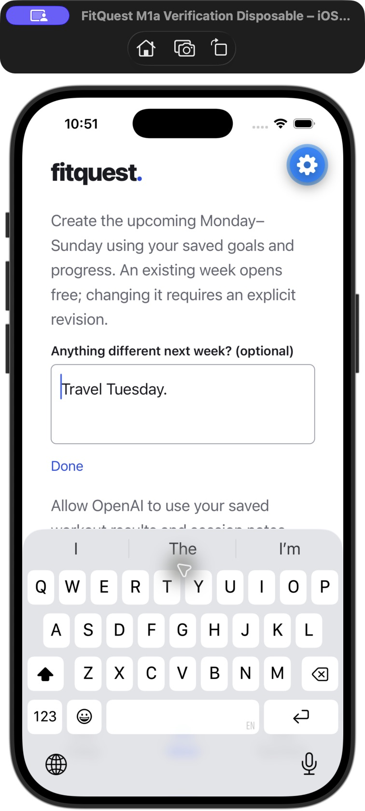
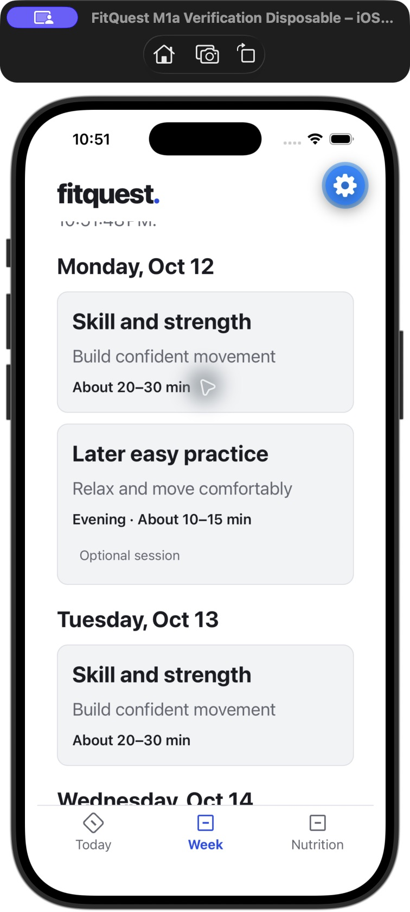
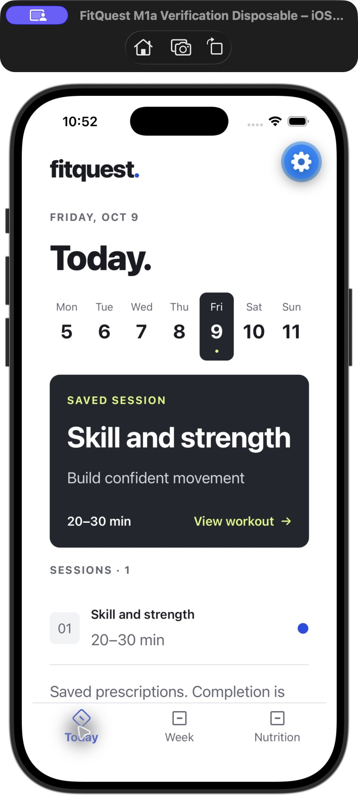

# Progress-informed next week — batch 2

Generate next week creates a distinct upcoming Monday–Sunday document from the saved timezone, original intake/profile, latest accepted baseline and actual progress. Optional changes stay in an encrypted account-scoped device draft; a persisted operation ID freezes retries across calendar changes. Existing target weeks reopen without purchasing a duplicate. Explicit revisions capture fresh context; failed retries retain the exact snapshot and usable accepted history. Intake revision is not manufactured to identify a new week.

History sharing requires separate explicit per-account permission naming OpenAI, workout results/notes including health feedback, weight history and planning purpose. Body-profile permission alone does not authorize it. Claim and actual dispatch check both permissions; withdrawal serializes against transmission and does not remove logs or accepted plans. Provider context excludes database/account IDs, names and emails. Free-text notes remain athlete data.

Context selection is deterministic: all ending-week journal records through the snapshot's local date, maximum 64; latest 16 older sessions in the preceding 56 days sharing an exact activity name; latest 14 non-future, nondeleted weight measurements. Older-name selection examines up to 512 unique names and does not establish comparable equipment, variation, units or load basis. Additional older sessions/measurements are explicitly flagged. All selected notes remain intact; more than 64 ending-week records or a snapshot exceeding 350 KB fails before dispatch. The latest dated measurement supersedes older profile weight for planning; otherwise profile weight is labeled as undated. Actual results, original prescriptions, unlogged/skipped, partial/full completion and completion-only versus measured work remain separate. No automatic progression formula is imposed.

Private snapshots store source IDs/revisions, baseline revision, summary/profile versions, exact dates, cutoff, context and fingerprint in existing owner-protected plan/generation storage. They are never returned in training API payloads. Reads expose only capture time and a changed-context indicator. Snapshots follow existing training retention/reset behavior; original journals, source snapshots, operation receipts and weight/food/library records remain independent and must survive training resets. Device next-week drafts have no expiry and are excluded from onboarding cleanup. No new public table or logging stream is added.

The existing single Sol 6.1 low request produces training and nutrition under document-week-v4. Overview-first acceptance remains free and hides workout details until accepted. Today and nutrition select accepted work by date, so future acceptance does not replace the current week. Saved weeks have pagination, with current-date work first. Legacy saved readers remain unchanged; generating next week requires an accepted document baseline. Automatic Sunday generation is batch 3 and is not included here.

## Verification

- 295 backend tests pass with isolated PostgreSQL and zero skips; 127 mobile tests and both TypeScript checks pass.
- Tests cover faithful mixed actuals/notes/weights and undated fallback, sparse/older data, context bounds, one concurrent dispatch, consent withdrawal/account isolation, frozen retries and uncertain outcomes, distinct weeks, duplicate reopen, free acceptance, failed revisions, changed context, date/DST/year boundaries, pagination, hidden details and preservation.
- Native production components with synthetic data were inspected on a disposable iOS simulator: compact setup, large-text multiline input above the keyboard, recoverable draft, permission decline/grant, upcoming overview with separate sessions/rest, and acceptance preserving current Today.
- The temporary Expo preview, database and disposable simulator were stopped. Owner Metro was only read: 38 source-map files match source; 5,206,967-byte bundle SHA-256 `5322a3a193f329ac2a41856a4775fcac53f4edc05f9fac50d4f4a845bfbb4b82`.
- Hosted migration `20261010025244_progress_informed_weeks` preserves all existing-field fingerprints and adds no user enrollment. Existing security advisories remain: [RLS policy info](https://supabase.com/docs/guides/database/database-linter?lint=0008_rls_enabled_no_policy), [disabled leaked-password protection](https://supabase.com/docs/guides/auth/password-security#password-strength-and-leaked-password-protection). Existing performance notices and the not-yet-used new [journal index](https://supabase.com/docs/guides/database/database-linter?lint=0005_unused_index) were not broadened into unrelated changes.

## Phone check

With an accepted current plan, open Generate next week, review the history-sharing permission and optionally enter changes. Generate the upcoming week, review its overview and accept it. Confirm Today and Nutrition still show the current date; reopen the future week without another generation. Actual phone acceptance and live coaching quality remain unverified; no paid agent evaluation or owner regeneration was performed.
