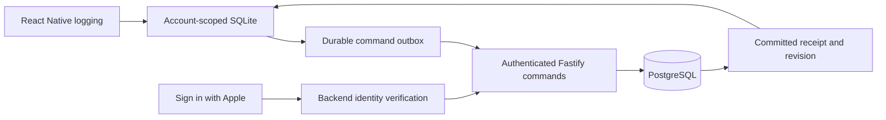

# FitQuest — M1 Architecture Proposal (Source Snapshot)

Captured by Project HQ: 2026-09-23. Source: task **Architecture**, ID `01a0d09d-2bf8-79e0-8a59-6b4043aa18f5`, completed turn `01a0d0d4-89c6-7c40-8d24-db1b69eff58a`.

Status: **Proposal, not implementation authorization.** The original response below is retained for cross-task reference. Read [HQ's review](../reviews/M1_ARCHITECTURE_REVIEW.md) for required clarifications and approval boundaries. Later accepted decisions take precedence; no package, migration, account configuration, or authentication policy becomes approved merely by appearing here.

Update, 2026-09-23: the [recovery addendum](M1_RECOVERY_ADDENDUM.md) has been reviewed and accepted by HQ as the technical recovery baseline. It supersedes conflicting outbox, credential, refresh-replay, and transaction details below. In particular, do not implement the original two-minute encrypted refresh-response replay mechanism. The original response is retained unchanged as historical evidence; use [HANDOFF.md](../HANDOFF.md) for current implementation and verification status.

## Original Architecture response

**M1 should use one versioned actual-session aggregate, persisted locally with an outbox and synchronized through authenticated, idempotent API commands.** This is the smallest design that can prove durable mixed-activity logging without introducing a general synchronization platform.

I read the updated handoff, all six required shared documents, both M0 evidence reports, and the relevant `rebuild/` package boundaries. The approved Expo/React Native stack and HealthKit deferral govern this proposal. No files were changed, dependencies installed, migrations run, or checks executed.

Verified current state: M0 contains a foundation screen, strict shared liveness contract, and Fastify liveness route. Authentication, athlete endpoints, SQLite and PostgreSQL are absent. Debug/Fast Refresh and physical-device verification remain outstanding. Everything below is an **M1 recommendation for HQ review**, not an approved implementation.

The proposed increment has three boundaries:



`packages/contracts` should own strict Zod request/response schemas and pure validation. Mobile owns SQLite, the outbox and native authentication adapters. The API owns authorization, PostgreSQL transactions and provider verification. Mobile never receives database credentials.

### Proposed records and contracts

The **required minimal profile** is an explicitly completed setup containing:

- A validated IANA timezone, suggested from the device and editable.
- Display-unit preferences, defaulting to pounds and miles.
- An optional display name or nickname.

Birth date, sex, body measurements, goals, schedule and equipment inventory are unnecessary for M1’s logging outcome. Goal interpretation and broader athlete context remain M2. A successful profile command records setup completion server-side; the client cannot manufacture a server completion timestamp.

A locally completed profile permits offline capture after an authenticated account has been established. Its command must synchronize before session creation. First-time account creation requires connectivity.

The following representative shapes are sufficient to implement the M1 contract. UUIDs, dates, decimal strings and units require runtime validation; TypeScript aliases alone are not validation.

```ts
type UUID = string;
type Instant = string;   // RFC 3339, canonical UTC on the wire
type LocalDate = string; // YYYY-MM-DD
type Decimal = string;   // bounded, non-exponent decimal representation

type Quantity<U extends string> = {
  value: Decimal;
  unit: U;
  accuracy: "reported" | "estimated";
};

type Mass = Quantity<"lb" | "kg">;
type Duration = Quantity<"s" | "min">;

type AthleteProfileInput = {
  displayName: string | null;
  timeZone: string;
  units: { load: "lb" | "kg"; distance: "mi" | "km" };
};

type Load =
  | {
      kind: "external";
      mass: Mass;
      basis: "total" | "per_dumbbell" | "per_implement";
      implementCount: number | null;
    }
  | { kind: "bodyweight" }
  | {
      kind: "assisted";
      assistance: Mass | null;
      method: string;
    };

type ResultCommon = {
  id: UUID;
  observedAt: Instant | null; // actual performance time, if known
  capturedAt: Instant;       // client entry time
  side: "left" | "right" | "bilateral" | "alternating" | "not_applicable";
  notes: string | null;
  source: "manual";
  voided: boolean;
};

type StrengthResult = ResultCommon & {
  kind: "strength";
  repetitions: number | null;
  repetitionBasis: "movement_cycles" | "per_side" | "total_alternating";
  load: Load | null;
  rpe: Decimal | null;
  rir: Decimal | null;
};

type TimedResult = ResultCommon & {
  kind: "timed";
  duration: Duration | null;
  durationMethod: "manual" | "confirmed_timer" | null;
};

type ActualActivity = {
  id: UUID;
  name: string;
  variation: {
    id: UUID;
    label: string;
  };
  equipment: {
    instanceId: UUID | null;
    label: string;
  } | null;
  outcome: "started" | "completed" | "partial" | "skipped";
  startedAt: Instant | null;
  endedAt: Instant | null;
  results: Array<StrengthResult | TimedResult>;
};

type ActualSessionInput = {
  id: UUID;
  origin: "unplanned";
  title: string | null;
  status: "started" | "completed" | "ended_early" | "voided";
  startedAt: Instant;
  endedAt: Instant | null;
  timeZone: string;
  localDate: LocalDate;
  activities: ActualActivity[];
  correctionReason: string | null;
};

type Command =
  | {
      contractVersion: 1;
      operationId: UUID;
      kind: "profile.put";
      expectedRevision: number; // 0 means create
      payload: AthleteProfileInput;
    }
  | {
      contractVersion: 1;
      operationId: UUID;
      kind: "session.put";
      expectedRevision: number;
      payload: ActualSessionInput;
    };

type CommandReceipt = {
  operationId: UUID;
  resource: { kind: "profile" | "session"; id: UUID };
  revision: number;
  committedAt: Instant;
  requestHash: string;
};

type ResourceResponse<T> = {
  accountId: UUID; // assigned from verified identity
  revision: number;
  committedAt: Instant;
  data: T;
};

type ApiError = {
  requestId: UUID;
  code: string;
  message: string;
  retryable: boolean;
  operationId?: UUID;
  currentRevision?: number;
  fieldErrors?: Array<{ path: string; code: string }>;
};
```

Important semantics:

- **`null` means unknown or unentered; zero is an explicit value.** Blank repetitions never become zero. Zero repetitions can describe an unsuccessful attempt; zero duration cannot contribute positive activity time.
- `bodyweight` is a load basis, not a fabricated mass. Unknown assistance stays unknown.
- `25 lb per dumbbell` remains distinct from `50 lb total`. Do not multiply without a known implement count, and preserve the original entry.
- Left and right results are separately addressable. Bilateral repetitions count movement cycles; alternating counts require their explicit basis.
- Different variation or machine identities are not comparable merely because names or displayed weights match. Unknown identity means comparability is unknown.
- Session completion changes no child result. A completed session may contain partial or skipped activities. A skipped activity has no performed results.
- An empty session can be started and later voided; it cannot silently become completed exercise.
- M1 rejects prescription fields. Future prescription linkage will be an explicit optional reference introduced through a contract extension.
- Future distance, interval and skill result variants extend the discriminated union. Unsupported variants are rejected explicitly, not flattened into strength sets.
- Corrections retain stable IDs and create new revisions. Previously saved results are voided explicitly rather than disappearing through omission.

For example, an entered dumbbell set can contain `repetitions: 8`, `mass: 25 lb`, `basis: per_dumbbell`, and `implementCount: 2`. An entered timed activity can contain `duration: 600 s`. Those examples belong in synthetic tests, not runtime defaults.

`startedAt` and `endedAt` are actual session times. `capturedAt` describes data entry, while the server supplies `committedAt`. Do not substitute one for another.

Derive `localDate` from the session’s start instant and captured timezone, and validate that relationship. Crossing midnight does not split the session. Travel or changing profile timezone does not relabel old records. A timezone correction is a new revision. Reject end-before-start and require confirmation of suspicious clock changes rather than silently repairing them.

Timer drafts should persist start/pause/resume anchors and accumulated duration at transitions. A resumed timer does not automatically prove performed activity; the athlete confirms its result. Keep partially entered form text in local draft storage until it becomes a valid command.

### SQLite and local synchronization

Recommend **`expo-sqlite`**, using the SDK 57-compatible version selected and pinned during Engineering’s authorized installation. It supports the shared iOS/Android direction and persistence across restarts.

Use `withExclusiveTransactionAsync`, executing every transactional statement through its supplied transaction handle. Expo documents that ordinary `withTransactionAsync` can include unrelated interleaved queries. Use bound parameters for user values. [Expo SQLite](https://docs.expo.dev/versions/v57.0.0/sdk/sqlite/)

The local store needs only:

| Local data | Purpose |
|---|---|
| Account/store metadata | Confirm database ownership and schema version |
| Profile | Required setup and current local projection |
| Active and selected recent sessions | Resumable logging and useful cached records |
| Draft fields/timer state | Recover unfinished input without creating facts |
| Immutable pending commands | Retry and dependency ordering |
| Acknowledged base snapshots/revisions | Conflict comparison and server-confirmed state |
| Migration ledger | Version and checksum verification |

This is a scoped cache and pending-write store, not a mirror of PostgreSQL.

Propose one database per **environment and internal account ID**, with ownership metadata checked whenever opened. Route writes through one serialized queue. Initialize foreign keys, WAL journaling and `synchronous=FULL`; the latter trades some write performance for stronger commit durability. [SQLite pragmas](https://www.sqlite.org/pragma.html#pragma_synchronous)

For private records, recommend the same adapter with **SQLCipher enabled**, using a random per-account database key in SecureStore. This requires a native build; SQLCipher is not supported in Expo Go. Key loss must produce a recovery error, never automatic deletion or recreation over pending records. [SQLCipher support](https://docs.expo.dev/versions/v57.0.0/sdk/sqlite/#sqlcipher)

Store keys and refresh credentials with `WHEN_UNLOCKED_THIS_DEVICE_ONLY` on iOS. SecureStore uses Keychain, whose entries may survive reinstall; therefore reinstall must not silently reactivate an old login. This behavior needs explicit tests. [Expo SecureStore](https://docs.expo.dev/versions/latest/sdk/securestore/)

Migrations should be numbered, checksum-verified and forward-only. Apply each migration and its ledger update atomically before opening the UI for writes. Preserve pending operations across upgrades. On failure, retain the database and report recovery needed; never fall back to an empty store.

Each valid save performs **one local transaction**:

1. Write the new local projection.
2. Append an immutable command and dependency information.
3. Advance the local revision.
4. Commit.
5. Only then report “Saved on this device.”

The outbox sends commands in order per aggregate. For an acknowledged server revision `3`, two queued saves expect revisions `3` and `4`; every newly accepted command advances exactly once. The second waits for the first receipt. Profile creation is a prerequisite for session creation.

Do not modify a command after dispatch. Do not coalesce commands in M1. On receipt, atomically acknowledge that operation and advance the server base while preserving newer local edits.

UI state should expose two dimensions:

- **Local:** editing, saving, saved, or local-save failure.
- **Synchronization:** pending, sending, confirmed, needs sign-in, conflict, or rejected.

A successful acknowledgement for an older revision must not mark a newer local edit synchronized. A process crash can turn `sending` back into retryable pending; the unchanged operation ID makes that safe.

### API transactions, retries and conflicts

Proposed endpoints:

| Endpoint | Behavior |
|---|---|
| `POST /v1/commands` | Apply one profile/session command |
| `GET /v1/me` | Return verified internal account and setup status |
| `GET /v1/profile` | Return server-confirmed profile and revision |
| `GET /v1/sessions/:id` | Return an owned session and revision |
| `GET /v1/sessions?cursor=…` | Bounded, owner-scoped summary listing |
| `GET /v1/operations/:operationId` | Recover an owned committed receipt |
| Authentication endpoints below | Establish, refresh and revoke sessions |

Reads never overwrite dirty local projections. M1 only downloads active/selected records; it does not need a change-data-capture service. Use `Cache-Control: no-store` for private API responses so application-controlled SQLite owns caching.

A minimal PostgreSQL design can use:

- Accounts and provider identities.
- Authentication sessions and token hashes.
- Profile current state and immutable revisions.
- Session current state and immutable revisions.
- Operation receipts.

Store session headers needed for ownership/listing relationally, with the validated bounded session body in JSONB. This keeps M1’s mixed results extensible. Later analytics can introduce relational projections when actual query needs justify them.

One session is the concurrency boundary. Whole-session conflicts are a deliberate M1 tradeoff: two devices editing different sets still conflict. This is safer and smaller than silently merging exercise history.

For each command, use one checked-out PostgreSQL connection and one transaction:

1. Validate the active FitQuest session and establish transaction-local account context.
2. Lock the relevant aggregate; serialize first creation through an account row lock.
3. Look up `(accountId, operationId)`.
4. If committed with the same request hash, return its original receipt.
5. If the hash differs, return `409 OPERATION_ID_REUSED`.
6. Compare `expectedRevision` with the current revision.
7. Validate profile prerequisites, state transitions and all nested records.
8. Insert the immutable revision, update current state and insert the receipt.
9. Commit before returning success.

The request hash covers canonical validated command content, including operation kind, payload, contract version and expected revision. Hashing excludes authorization headers and transport metadata. A retry receipt lookup precedes the revision comparison, so a successful lost-response retry cannot become a false conflict.

Database constraints enforce unique operation receipts and aggregate revisions. With node-postgres, all statements in a transaction must use the same client rather than independent pool queries. [node-postgres transactions](https://node-postgres.com/features/transactions)

Retain successful receipts for the life of the associated M1 records; do not introduce expiry that could make an old retry execute again. Longer-term retention remains a separate policy gate.

Suggested errors:

| Status/code | Client action |
|---|---|
| `400 MALFORMED_REQUEST` | Preserve input; fix serialization or unsupported contract |
| `401 ACCESS_EXPIRED` | Perform one shared refresh attempt, then retry the same command |
| `401 SESSION_REVOKED` | Stop synchronization; require sign-in |
| `404 RESOURCE_NOT_FOUND` | Same response for missing and other-user resources |
| `409 REVISION_CONFLICT` | Block that aggregate’s queue; fetch owned current revision |
| `409 OPERATION_ID_REUSED` | Treat as an integrity defect; never automatically invent a new ID |
| `409 PROFILE_REQUIRED` | Synchronize valid profile first |
| `422 VALIDATION_FAILED` | Preserve draft; show field errors |
| `413 PAYLOAD_TOO_LARGE` | Preserve local work; report limit |
| `429 RATE_LIMITED` | Respect retry delay |
| Network timeout / `503` | Retry unchanged command with bounded backoff and jitter |

Propose an initial 256 KiB command limit and 500 results per session; these are operational limits to verify against representative sessions, not workout prescriptions.

On conflict, retain the acknowledged base, current local version and latest server version. Show the differing fields/results. The athlete can adopt the server state or apply reviewed local corrections to it. The latter creates a new operation against the fetched revision. Preserve original blocked commands as superseded local history. No silent last-write-wins and no automatic “force save.”

### Authentication and account isolation

Use `expo-apple-authentication` behind an iOS adapter, with a provider-independent internal account UUID. Identify Apple accounts through verified issuer/subject and configured application namespace. Do not link accounts by email or trust the client’s `user` field.

Proposed authentication shapes:

```ts
type AppleChallengeResponse = {
  challengeId: UUID;
  nonce: string;
  state: string;
  expiresAt: Instant;
};

type AppleExchangeRequest = {
  challengeId: UUID;
  state: string;
  identityToken: string;
  authorizationCode: string;
};

type FitQuestSessionResponse = {
  accountId: UUID;
  sessionId: UUID;
  accessToken: string;
  accessExpiresAt: Instant;
  refreshToken: string;
  refreshExpiresAt: Instant;
  revocationToken: string; // can revoke this session only
};

type RefreshRequest = {
  operationId: UUID;
  refreshToken: string;
};

type LogoutRequest = {
  revocationToken: string;
};
```

Proposed flow:

1. `POST /v1/auth/apple/challenge` creates a short-lived, single-use random nonce/state.
2. The native request receives those values.
3. `POST /v1/auth/apple/exchange` receives the identity token and authorization code.
4. Verify Apple signature using its fixed JWKS endpoint, approved algorithms, issuer, configured audience, expiration and nonce; match state/challenge.
5. Exchange the authorization code server-side with Apple using server-held client credentials; verify returned identity consistency.
6. Resolve/create the internal account under a unique provider-identity constraint.
7. Atomically consume the challenge and create a FitQuest session.

The pinned native adapter must have a nonce round-trip test; no undocumented double hashing. Client profile/name fields are user input, not identity proof. Apple documents server-side verification and authorization-code exchange. [Verifying a user](https://developer.apple.com/documentation/signinwithapple/verifying-a-user), [token validation](https://developer.apple.com/documentation/signinwithapplerestapi/generate-and-validate-tokens)

Recommend **opaque random FitQuest tokens**, hashed in PostgreSQL, rather than introducing a second JWT system. Proposed defaults: 15-minute access tokens and rotating refresh sessions with 30-day inactivity and 90-day absolute limits. These are configurable engineering defaults for review.

Check the session’s revoked state on every authenticated request. Serialize revocation with write authorization so a write that checks authorization after logout cannot commit. Never authorize from an expired locally decoded token.

Refresh requires special retry handling:

- Persist a refresh operation ID in SecureStore before sending.
- Single-flight refresh on the client.
- Atomically consume the current refresh token and issue the next pair.
- Retain an encrypted response receipt for a short recovery window, proposed at two minutes.
- Same old token plus same operation ID within that window returns the same issued pair, provided the session remains active.
- Reuse with another operation ID revokes the token family.
- After the recovery window, require fresh Apple sign-in rather than guessing whether rotation succeeded. Pending activity remains intact.

A failed SecureStore write must not be reported as successful credential persistence.

Logout immediately disables local access and removes usable access/refresh credentials. Send `POST /v1/auth/logout` using a separate high-entropy revocation-only token. If offline, retain only that limited capability for retry and report that server revocation is pending. A revocation token cannot read records or refresh a session. Logout is idempotent and revokes all tokens in that FitQuest session.

Apple credential revocation is separate from ordinary FitQuest logout. Listen for native revocation and check credential state on foreground. Backend validation of Apple refresh credentials provides an independent check; propose checking when the prior verification is older than 24 hours, failing closed for further session renewal if validation cannot be completed. Registered Apple server notifications can shorten that window once hosted configuration is separately authorized. [Apple revocation guidance](https://developer.apple.com/documentation/technotes/tn3194-handling-account-deletions-and-revoking-tokens-for-sign-in-with-apple?changes=__5_6&language=objc)

M1 can implement and test notification verification locally, but cannot claim live webhook delivery. Account deletion and retention policy remain later gates; this proposal does not approve them.

Account switching must:

1. Stop the old account’s synchronization worker.
2. Increment an account-session generation marker and cancel outstanding requests.
3. Close its database and clear in-memory state, navigation and query caches.
4. Reject late responses whose account/generation no longer matches.
5. Open the next account’s distinct store only after identity verification.

Unsent records remain encrypted and locked to the original account. Returning to that verified account resumes its queue. Design should offer explicit discard or continued locked retention during logout; it must never silently discard pending work or move it to the next account.

Backend ownership enforcement should combine:

- Account identity derived exclusively from the authenticated session.
- Owner-qualified reads and writes.
- Composite foreign keys carrying account ownership.
- Row-level security on athlete tables, including `USING` and `WITH CHECK`.
- A non-owner runtime role without `BYPASSRLS`; a separate migration role.
- Transaction-local account context on pooled connections, with deny-by-default behavior when absent.
- A narrowly scoped authentication repository for identity/session tables.

PostgreSQL documents owner and privileged-role bypasses, so policies alone are insufficient. [PostgreSQL row security](https://www.postgresql.org/docs/current/ddl-rowsecurity.html)

Tokens, authorization codes, Apple credentials and activity payloads must be excluded from logs. Error output carries identifiers and field paths, not another user’s data.

### Local database setup and test identities

Engineering should propose a disposable PostgreSQL container under `rebuild/`, using a pinned supported image/digest, a dedicated port bound to `127.0.0.1`, and separate development/test databases.

Tests should use temporary storage and synthetic data. The normal development database may persist across restarts in a dedicated local volume. No prototype environment files, credentials, migrations or seeds should be inherited.

Migration/reset tooling should require all of:

- Explicit `local-development` or `test` environment.
- Loopback-only connection configuration.
- A rebuild-specific database name.
- A database sentinel identifying it as disposable.
- Explicit target selection, with no fallback to a generic `DATABASE_URL`.

Fail before connecting to an unexpected host. Database/schema migration tests run only in these disposable instances. Container installation, if unavailable, needs a separate setup decision; it is not part of this read-only task.

Production authentication and fixtures must remain distinguishable:

| Mode | Permitted evidence |
|---|---|
| Unit tests | Inject a verifier and synthetic signed tokens/JWKS; test valid and invalid claims |
| Local integration | A separate test-only server entry point supplies two synthetic principals while exercising real authorization, transactions and synchronization |
| Production entry point | Apple verifier only; no fixture header, identity selector or runtime bypass |
| Real authentication verification | Signed native FitQuest build, real Apple exchange, refresh and revocation on a physical device |

Fixture support must be absent from the normal server entry point and guarded against non-loopback operation. Tests must prove the production entry point rejects fixture identities.

Expo warns that Expo Go identifiers can differ from standalone apps, and `getCredentialStateAsync` always errors in the iOS simulator. Therefore neither Expo Go nor simulator fixtures establish production authentication. [Expo AppleAuthentication](https://docs.expo.dev/versions/v57.0.0/sdk/apple-authentication/)

### Verification and acceptance boundaries

| Test group | Required evidence | Environment | Criteria |
|---|---|---|---|
| Truthful actuals | Blank versus zero; bodyweight versus unknown load; per-dumbbell versus total; explicit side/repetition basis; completed session does not complete child work | Contracts + simulator | AC-04, AC-10 |
| Time semantics | Midnight, DST transitions, travel, corrected timestamps, end-before-start, unknown observation time, interrupted timer | Unit + simulator | AC-04, AC-10 |
| Local durability | Kill/relaunch after save; injected rollback; storage failure; migration failure; recovery of drafts and queued operations | Native SQLite simulator; physical confirmation | AC-05, AC-11 |
| Retry safety | Server commit with lost response; simultaneous duplicate requests; same ID/different payload; restart during send; malformed success response | Backend + mobile integration | AC-05 |
| Concurrency | Two devices edit one revision; exactly one wins; loser retains local state; dependent queue pauses; reviewed resolution | PostgreSQL + two client harnesses | AC-05 |
| Isolation | A reads/updates B’s profile/session/receipt; forged IDs; missing/wrong transaction context; connection-pool reuse; RLS insert/update attempts | Real local PostgreSQL using runtime role | AC-01, AC-10 |
| Account switching | A has pending work; switch to B; late A response arrives; no display/cache/replay leakage; return to A resumes correctly | Simulator + physical confirmation | AC-01, AC-05, AC-10 |
| Apple verification | Invalid signature/algorithm/issuer/audience/nonce; expired or replayed challenge; code failure; JWKS rotation/outage; production rejects fixtures | Backend fixtures, then live native integration | AC-01, AC-10 |
| Session lifecycle | Expiry; rotation; refresh response loss; repeated old token; logout race; offline logout; revoked session rejected; credential-store failure | Backend + native tests | AC-01, AC-05, AC-11 |
| Device authentication | Native sign-in, cancellation, credential-state/revocation behavior, SecureStore persistence and locked-device behavior | Physical iPhone + Apple | AC-01, AC-10 |
| Outages and recovery | API/database unavailable, offline capture, reconnect, bounded retries, restart with pending work | Backend fault injection + native app | AC-05, relevant AC-11 |
| Scope honesty | No Health permissions, imported-data claims, provider calls, AI success states or runtime athlete fixtures | Static configuration + walkthrough | Relevant AC-11; deferred AC-06 boundary |

M1 supplies **partial evidence** for AC-01/04/05/10 and the outage portion of AC-11. It cannot close AI-context isolation, prescription behavior, atomic plan publication or model/budget failures because those capabilities do not exist yet.

The main implementation risks are native dependency compatibility, SQLite transaction interleaving, encryption-key recovery, refresh-rotation retries and whole-session conflicts. Test these directly. Native tests must exercise the actual installed adapter; a JavaScript SQLite mock is insufficient.

### HQ review and remaining gates

There is no unresolved product question that prevents HQ reviewing these contracts. The choices above—including adapter, encryption, aggregate granularity, token defaults and conflict behavior—are reversible technical recommendations for HQ to approve or amend.

Owner authorization is genuinely required before changing Apple/cloud configuration or the permitted device-network setup:

- Confirm ownership/use of the current placeholder bundle identifier, `com.fitquest.rebuild`, before registering an App ID.
- Enable Sign in with Apple, provision signing and create required server credentials through a separately authorized task.
- Authorize a restricted physical-device-to-local-API transport. The phone cannot reach the Mac’s API through its own `127.0.0.1`; the present loopback boundary must not be silently widened.

For M1 development, retain the current Expo SDK’s technical OS floor and tested simulator target; make no public supported-device claim until the compatibility matrix is approved and tested.

HQ should first close the existing Debug/Metro workflow follow-up and obtain Design’s logging/save/conflict/account-switch flow. Then issue a bounded Engineering handoff in three checkpoints: contracts and local capture; disposable API/database synchronization; production-path authentication and device verification.

**M1 must not be marked fully authenticated on fixture evidence.** If Apple configuration or physical testing remains unauthorized, Engineering should report the proven local portions and the outstanding authentication gate separately.

This proposal introduces no AI, HealthKit, nutrition schema, hosting change, retention schedule or automatic replan policy. It is ready for HQ review; implementation has not started.
