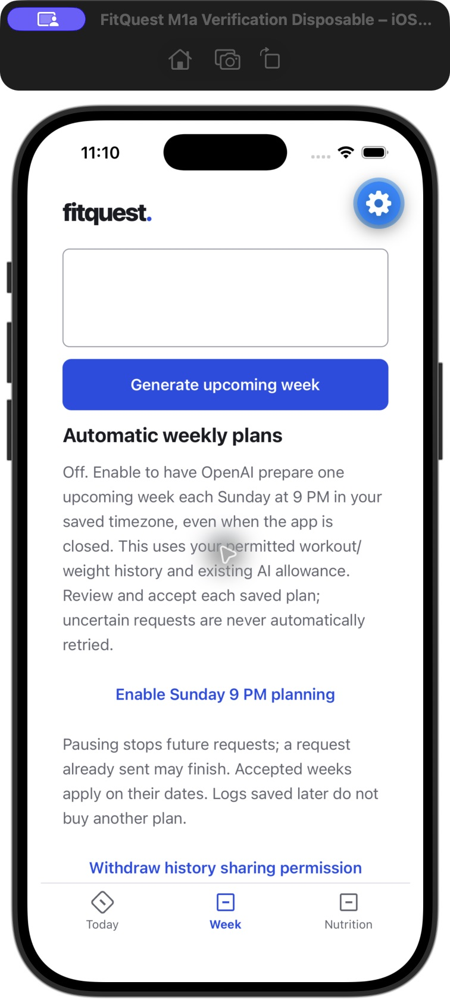
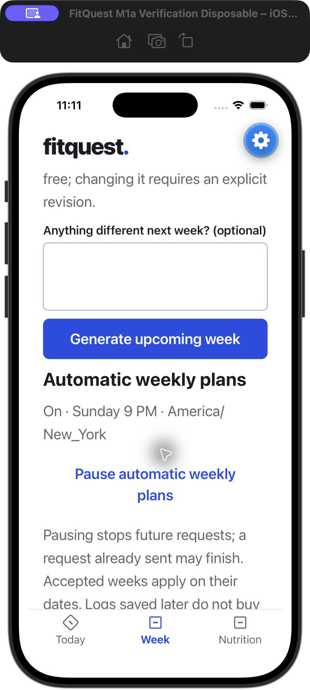

# Automatic Sunday planning — batch 3

After an accepted document week and both existing OpenAI-sharing permissions, Generate next week exposes an explicit Enable Sunday 9 PM planning action. Nobody is enrolled by migration or release. The saved timezone is captured at enrollment; pause/resume uses owned revisions and resume captures the current saved timezone. Enrollment does not immediately generate a plan. A trigger must occur after enrollment. Pause remains available after history permission is withdrawn; requests already sent may finish.

The existing paid Render web service runs a production-only 60-second scan, including startup recovery. No separate service, cron resource, credential or public trigger endpoint is added. Internal account discovery is a private, fixed-search-path SQL function returning only enabled account IDs in keyset pages of 100, executable solely by the existing backend role. Owned transactions retain forced RLS. Interactive routes always require the verified live session; only the server-created scheduler store operates from explicit enrollment without an active mobile session.

At Sunday 21:00 local time, the eligible target becomes upcoming Monday–Sunday. After downtime, only the latest eligible current/upcoming week can be generated; missed obsolete weeks are skipped. Calendar logic is timezone/DST/year aware. The single existing Sol 6.1 low training-plus-nutrition request, progress snapshot, consent checks and permanent ledger/caps remain authoritative. Per-account locks, target-week identity and generation attempts serialize workers and manual requests. An existing manual draft or ready week wins without a replacement request.

Reservations created before a process stops can resume after their lease only when durable state proves dispatch never began. Before any scheduled provider call, a dispatch marker commits, then current enrollment/revision, date window and both sharing permissions are checked under the account lock. If the process stops between that marker and actual transmission, the outcome is conservatively uncertain: it is not automatically retried, and its reservation remains accounted. Provider failures/refusals/incomplete/invalid results also require explicit retry. Pausing before transmission prevents the call; any completed result already sent can still be saved for review. Late logs never trigger another paid request.

Saved upcoming drafts require Use this plan. Acceptance does not replace the current date's work or nutrition. Monday uses the accepted date-matching version; unaccepted or expired weeks never become current. Foreground/calendar refresh retrieves saved weeks while protecting unsent feedback. Today uses the saved planning timezone; diary targets remain tied to the selected diary date. No notification system is included.

## Storage and preservation

Migration `20261010030300_automatic_weekly_planning.sql`, hosted as `20261010031135_automatic_weekly_planning`, adds private forced-RLS `weekly_schedules` and internal scheduled/dispatch metadata in existing training tables. There is no enrollment backfill and no FK from enrollment to resettable plans. Enrollment persists until explicitly paused or account deletion; retain it during the standing nine-table training reset and fingerprint it alongside journals/weight/food/library/accounting. Source snapshots and real records remain independent of training content. Training reset does not revoke consent, invent a baseline or automatically purchase an initial plan.

Before/after migration fingerprints preserve every existing data group. The only FK inventory addition is the new enrollment → account relationship. Security advisors retain the preexisting [budget-policy info](https://supabase.com/docs/guides/database/database-linter?lint=0008_rls_enabled_no_policy) and [leaked-password warning](https://supabase.com/docs/guides/auth/password-security#password-strength-and-leaked-password-protection). The new policy already wraps current_setting in SELECT; the advisor still flags it alongside existing policies under [RLS init-plan warnings](https://supabase.com/docs/guides/database/database-linter?lint=0003_auth_rls_initplan). The new partial index is unused before enrollment traffic, an [informational notice](https://supabase.com/docs/guides/database/database-linter?lint=0005_unused_index). No unrelated auth or index changes were made.

## Evidence and limits

Application `2e779e5a164f7665559a3828cdf426213d650158` is [Live](https://dashboard.render.com/web/srv-d828o7pj2pic739le3ug/deploys/dep-db4qrevlk1mc73fms570). All 40 runtime artifacts match the tested build, restricted live scheduler discovery succeeds with zero enrollments, and health plus 66 private-route rejection/no-store checks pass. Owner Metro matches 39 source-map files. Fresh 11:16:30 PM EDT preservation readback matches all protected records and 146 permanent attempts; training was already empty, so no additional deletion occurred. Exact hashes and release details are in the root README.

301 backend checks pass with isolated PostgreSQL and zero skips, including explicit enrollment/session-free worker execution, pause/withdrawal fences, concurrent dedupe, recovery before dispatch, no uncertain/failed automatic retry, cap denial, manual-week precedence, skipped obsolete backlog, RLS and enrollment reset survival. 128 mobile checks pass, covering enrollment, pause after withdrawal, recovery after a lost enrollment response, and date-correct acceptance/foreground rollover. Both TypeScript checks pass.

Native synthetic production-component checks confirm the off disclosure, explicit enable, saved timezone and pause at compact width and the largest standard Dynamic Type size. Screenshots below are synthetic, not production enrollment. At the largest accessibility-only text setting, the preexisting shared brand/header and bottom navigation become oversized/overlap; this broader shell limitation is not claimed fixed. Temporary Expo/PostgreSQL and the disposable simulator are stopped; owner Metro remains untouched. Physical-phone acceptance, a real Sunday dispatch and live coaching quality are not yet observed. No paid agent evaluation or owner regeneration occurred.

## Phone check

After accepting an initial plan, open Generate next week, allow the history-sharing permission if desired, then choose Enable Sunday 9 PM planning. Confirm the displayed timezone. The next eligible Sunday prepares a draft even with the app closed; reopen Week and choose Use this plan after review. Acceptance before Monday preserves Sunday; Monday applies the accepted upcoming week. Pause automatic weekly plans stops future dispatches.
